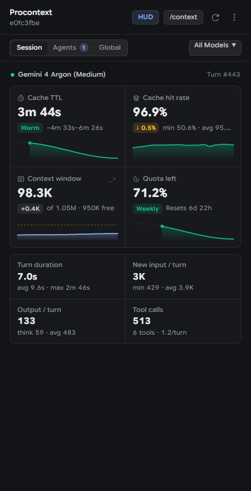
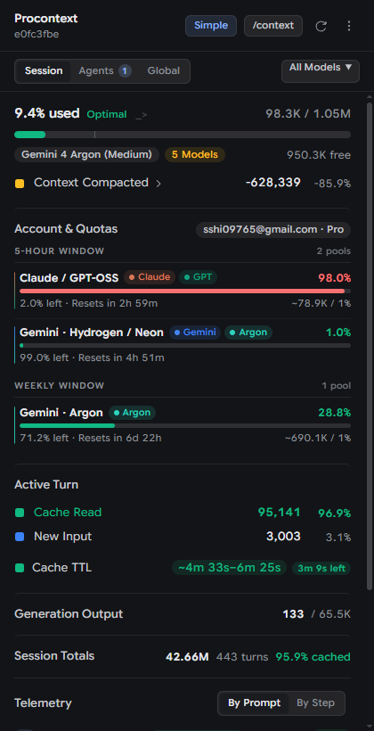
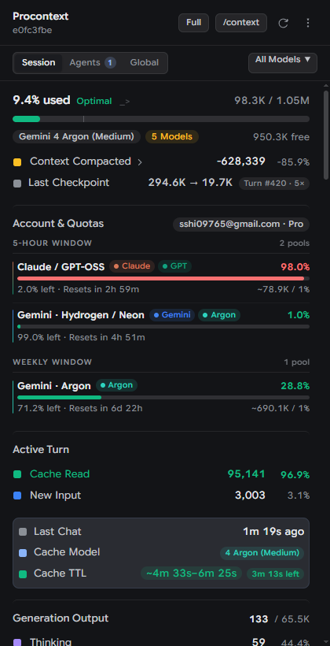
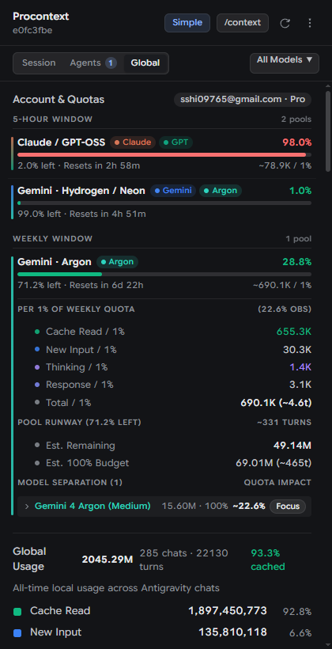

# Procontext

**Procontext** is a server-side token telemetry, prompt cache TTL tracker, and 5-hour / weekly quota correlation plugin for **Google Antigravity Desktop**.

It connects directly to Antigravity's local language server RPC endpoint to deliver exact, zero-approximation token accounting, learned prompt cache survival bounds, and empirical per-1% quota burn rates across active chats and subagents.

> **Fork Attribution**: Forked from [BlueNebula-Dev/token-context-meter](https://github.com/BlueNebula-Dev/token-context-meter) and expanded with the **Coding HUD**, **Simple / Full view modes**, **cross-chat Cache TTL survival learning**, **5h & Weekly Quota Pool correlation + runway estimation**, **3-level Tool Call & Context Compaction drill-downs**, **Subagent inspection**, and **per-account Global Usage snapshots**.

---

## Visual Preview

| Coding HUD (Default) | Simple Mode |
| :---: | :---: |
|  |  |
| **2×2 sparkline KPI cards + 4-cell coding stat strip** | **Essential metrics + latest 5 compact telemetry rows** |

| Full Mode (Session Ledger) | Global Usage & Quota Correlation |
| :---: | :---: |
|  |  |
| **Full turn breakdown, compaction checkpoints & tool trees** | **Per-1% quota token burn, pool runway & all-time ledger** |

---

## Why Procontext?

Client-side token meters approximate token volume by running character heuristics or local tokenizers (`tiktoken`) against visible chat text. Those estimates miss:

- Internal reasoning and thinking tokens (`thinkingTokens`)
- System prompts, developer instructions, and injected rules/skills
- Tool invocation schemas, arguments, and file/command return payloads
- Prompt cache reuse boundaries, cross-chat cache survival windows (TTL), and cache hit ratios
- Context compaction (`/compact`) checkpoints and reclaimed token deltas
- Shared 5-hour and weekly quota pool consumption across model families

**Procontext** queries the running Antigravity language server over Connect RPC (`GetCascadeTrajectory`, `GetUserStatus`, `GetCommandModelConfigs`), matching the exact server-side figures reported by the CLI `/context` command while persisting long-term cache and quota analytics locally.

---

## Display Modes

Switch modes at any time using the quick header pill (`HUD` → `Full` → `Simple`) or via the **`⋮`** main settings menu.

### 1. Coding HUD (`HUD` — Default)
Designed for low cognitive load while actively coding:
- **Subtle Running Model Strip**: Brand-colored dot (`Gemini`, `Claude`, `GPT`, `Argon`), active model name, and current turn number.
- **2×2 Primary Sparkline KPI Grid**:
  1. **Cache TTL**: Live countdown (`3m 44s`), cache state (`Warm` / `Expiring` / `Cold`), learned survival window (`~4m 33s–6m 26s`), and smooth S-curve decay gauge.
  2. **Cache Hit Rate**: Latest turn cache hit percentage, turn-over-turn delta, warm `min · avg` (automatically filtering out turn #1 cold starts and `/compact` prefix rewrites), and area sparkline.
  3. **Context Window**: Active context displayed in thousands (`98.3K`), per-turn delta (`+0.4K`), ceiling & free headroom (`of 1.05M · 950K free`), and a minimal un-pilled `_>` trigger to set a custom `K` compact threshold line on the sparkline.
  4. **Quota Left**: Strictly matches the active model's primary quota pool (5-hour or weekly), displaying remaining percentage (`71.2%`), pool window badge (`Weekly` / `5h pool` / `Wk %`), and reset countdown (`Resets 6d 22h`).
- **4-Cell Secondary Compact Strip**:
  - **Turn duration**: Latest turn duration + `avg · max`.
  - **New input / turn**: Fresh un-cached tokens + `min · avg`.
  - **Output / turn**: Generated output tokens + `think · avg`.
  - **Tool calls**: Total session tool invocations + unique tool count and calls/turn average.

### 2. Simple Mode (`Simple`)
Streamlined vertical dashboard for quick scanning:
- Shows **Window Utilization**, **Account & Quotas**, **Active Turn** (without meta rows), auto-compacted **Generation Output** and **Session Totals**, and the **latest 5 telemetry items** in single-line compact format.

### 3. Full Mode (`Full`)
Complete analytical breakdown for deep inspection:
- **Window Utilization & Context Compaction**: Capacity bar with subtle `_>` compact threshold tick, active model & multi-model badges, and an expandable **Context Compacted** `.cat-list` drill-down showing every compaction checkpoint (`Turn #N`, `before → after`, tokens saved, and `%` reduction).
- **Account & Quotas (5-Hour & Weekly Pools)**:
  - Groups pools by **5-Hour Window** (`Claude / GPT-OSS`, `Gemini · Hydrogen / Neon`) and **Weekly Window** (`Gemini · Argon`) with brand-colored family pills.
  - Expand any pool to inspect **Per 1% of Quota** empirical token burn (`Cache Read / 1%`, `New Input / 1%`, `Thinking / 1%`, `Response / 1%`, `Total / 1%`), **Pool Runway** (`~N turns`, estimated remaining token budget, estimated 100% pool budget), and **Model Separation** (color-coded per-model share with expandable token breakdown and one-click `Focus` filter).
- **Active Turn & Live Cache Lifespan Strip**:
  - Prompt token breakdown (`Cache Read` vs `New Input`) with live `+N` delta pills on updates.
  - Live 1-second ticker for `Last Chat`, `Cache Model`, and learned `Cache TTL` countdown.
- **Generation Output & 3-Level Tool Calls Tree**:
  - Splits output into `Thinking` and `Response & Tools` against the model's output ceiling.
  - Expandable 3-level **Tool Calls** tree: `Total Calls → Tool Name (count & share %) → Target File / Command`.
- **Paginated Telemetry Ledger (`By Prompt` | `By Step`)**:
  - **By Prompt**: Groups internal agent tool loops by user prompt boundary with model routing chains, estimated 5h/weekly quota cost, and cache hit status chips.
  - **By Step**: Granular per-LLM-call ledger with visual left-hand prompt-grouping brackets across steps and pages (`15` items/page).

---

## Tabs & Filtering

- **Session Tab**: Live telemetry for the active conversation (or currently inspected subagent).
- **Agents Tab**: Automatically discovers child subagents spawned by the current conversation, showing their role, model, turn count, and token volume. Click any subagent to inspect its full telemetry on the Session tab.
- **Global Tab**:
  - **Separated Per-Account Storage**: Automatically isolates global token ledgers, learned cache TTL bounds, quota correlation samples, and snapshots by logged-in account (`email · plan`).
  - **All-Time & Since-Reset Totals**: Aggregates all local Antigravity conversations in the background without blocking the UI.
  - **Manual & Auto 100% Quota Snapshots**: Saves named snapshots manually or automatically when a quota cycle hits 100%, plus full JSON export/import.
- **Per-Model Filter Dropdown**: Filter Session, Coding HUD, Quotas, and Global views to a single model or `All Models`.

---

## Plugin Architecture

```text
token-context-meter/
├── plugin.json                 # Antigravity plugin manifest (Procontext)
├── mcp_config.json             # MCP server registration
├── assets/
│   ├── logo.svg                # Plugin vector emblem
│   └── screenshots/            # README UI screenshots
│       ├── coding-hud.png
│       ├── simple-mode.png
│       ├── full-mode.png
│       └── global-quotas.png
├── sidecars/
│   └── meter/
│       ├── sidecar.json        # Sidecar auxiliary pane configuration
│       ├── index.html          # Procontext dashboard markup (HUD / Simple / Full)
│       ├── styles.css          # Host-themed styling, brand tokens & sparklines
│       ├── app.js              # Real-time dashboard & HUD controller
│       ├── server.js           # Sidecar bootstrap loader
│       ├── main.mjs            # Sidecar SDK and standalone HTTP server
│       ├── telemetry.mjs       # Connect RPC client, cache TTL learner & subagent scanner
│       └── global-store.mjs    # Per-account global ledger, quota correlation & snapshots
├── mcp/
│   └── server.mjs              # Model Context Protocol stdio server
└── skills/
    └── context/
        └── SKILL.md            # /context slash command definition
```

### MCP Tools (`mcp/server.mjs`)
Exposes three tools over stdio (`JSON-RPC 2.0`):
1. `get_token_context`: Returns live context window utilization, active turn breakdown, learned cache lifespan bounds, account & 5h/weekly quota pools, and session totals (supports optional `model` and `conversation_id` filters).
2. `get_quota_status`: Returns dedicated 5-hour and weekly quota pool progress bars, empirical tokens-per-1% burn correlation, remaining runway estimates, and per-model separation.
3. `get_turn_history`: Returns historical telemetry in either `prompt` or `step` aggregation mode.

---

## Installation

### Prerequisites
- Google Antigravity Desktop (`v1.15.0+`)
- Node.js (`v18+`)

### 1. Clone into Antigravity Plugins Directory

```bash
git clone https://github.com/NyeowsZ/token-context-meter.git ~/.gemini/config/plugins/token-context-meter
```

*(On Windows PowerShell)*:
```powershell
git clone https://github.com/NyeowsZ/token-context-meter.git "$HOME\.gemini\config\plugins\token-context-meter"
```

### 2. Enable in `~/.gemini/config/config.json`

```json
{
  "plugins": {
    "token-context-meter": {
      "enabled": true
    }
  },
  "sidecars": {
    "token-context-meter/meter": {
      "enabled": true,
      "schemaVersion": 1,
      "resolvedPermissions": {}
    }
  }
}
```

Restart Antigravity Desktop to load **Procontext** in the auxiliary side panel, or type `/context` in any chat.

---

## Credits & License

- Original plugin foundation by [BlueNebula-Dev/token-context-meter](https://github.com/BlueNebula-Dev/token-context-meter).
- **Procontext** redesign, Coding HUD, cache TTL survival learner, and quota correlation engine by [NyeowsZ](https://github.com/NyeowsZ/token-context-meter).
- Licensed under the MIT License.
